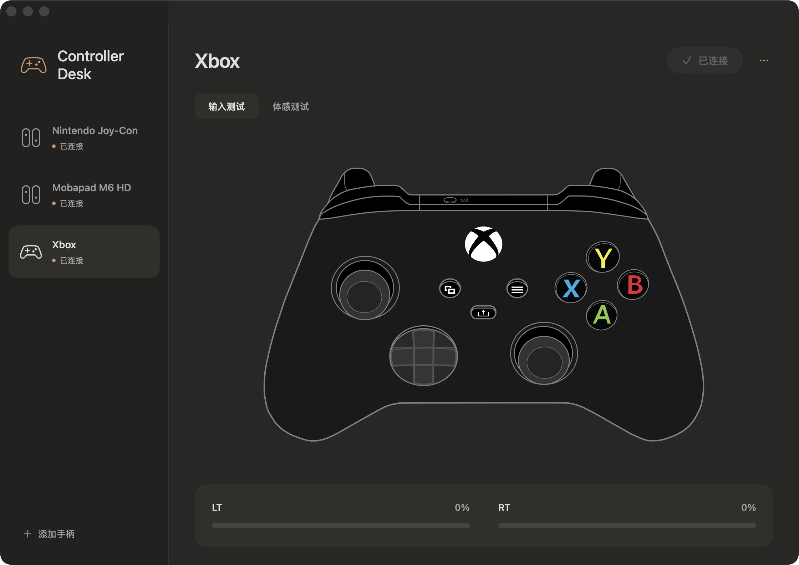

# Controller Desk

A small native macOS app for connecting and testing game controllers.

原生 macOS 手柄连接与实时测试工具。SwiftUI 界面，暖白 / 炭灰配色，按键、摇杆与体感数据在本机处理。



## 功能

- 管理 Nintendo Joy-Con、Mobapad M6 HD、Xbox，以及系统已识别的其他手柄。
- 左右 Joy-Con 可以作为一组加入和连接。跨主机后，点击连接并手动按 SYNC，应用处理目标设备的旧配对记录。
- 添加新手柄不会主动断开其他手柄；已在线的半边 Joy-Con 会保留。
- 实时查看按键、八方向九宫格、摇杆位置和模拟扳机行程，扳机数值直接绘制，无缓动。
- 读取 Joy-Con 的实际外壳 / 按键 RGB，以及陀螺仪、加速度和电量。
- Yuzu/Eden Joy-Con 矢量预览、独立绘制的 M6 HD 矢量预览，以及 MIT Xbox SVG。

## 安装和首次使用

从 [Releases](https://github.com/xiuxiua8/controller-desk/releases) 下载应用 ZIP，解压后将 `Controller Desk.app` 放入“应用程序”。当前发布包在 Apple Silicon、macOS 14 或更新版本上构建。

应用使用本地 ad hoc 签名，尚未经过 Apple notarization。也可以按下方说明从源码构建。若系统阻止打开，请使用 macOS 提供的标准应用审核入口；本项目不要求关闭 Gatekeeper、SIP 或其他安全保护。

1. 首次连接新设备，先在 macOS 蓝牙设置中完成配对。
2. 打开 Controller Desk，允许应用使用 Bluetooth，点击“添加手柄”，选择类型及对应设备。原装 Joy-Con 和 M6 HD 可能都叫 Joy-Con，请按实际型号选择预览，并区分设备地址。
3. 左右两只可一起加入，也可先加入一只。Xbox 等独立手柄一次添加一个。
4. 平时按普通按键唤醒即可。刚在 Switch 等其他主机使用过时，点击“连接到 Mac”，再让目标手柄进入 SYNC 闪灯。
5. 在“输入测试”检查按键与行程，在“体感测试”查看传感器。地址、输入频率和许可说明收在设备菜单内。

设备登记保存在本机 `~/Library/Application Support/Controller Desk/devices.json`，颜色缓存与显示偏好使用应用本地偏好设置。公开仓库和安装包不预置任何真实设备地址。

## 边界

- 应用不能给固件增加多主机配对记忆；跨主机后仍需手动按 SYNC。
- Xbox BLE 曾出现断开请求返回成功、物理连接仍在的情况。应用会核对实际状态并提示使用系统蓝牙的“断开连接”，无需“忽略设备”。应用内一键断开这类设备尚不能保证。
- 原装双 Joy-Con 同时连接时，本机曾复现一侧物理报告频率变慢，独立采样也能观察到；尚未彻底解决。60 Hz 绘制不代表 60 Hz 物理输入或已测得端到端延迟。
- 静止校准只影响本应用的显示，不会自动修改游戏、模拟器或手柄固件。转角倍率与 dead zone 是两个不同的设置；本应用目前不提供游戏体感倍率控制。
- Xbox 没有可供本应用读取的陀螺仪。M6 HD 使用白色参考外形；设备报告的 RGB 不一定等于实物外壳颜色。Xbox 使用标准黑色图稿。
- 其他手柄的 GameController 支持取决于 macOS；完整绘图目前针对上述三种设备。Intel Mac 尚未实机验证。

## 构建和验证

需要 macOS 14+、Xcode Command Line Tools、Python 3，以及通过 Homebrew 安装的 blueutil。运行单元 / 图形测试另需 Node.js。

```sh
xcode-select --install
brew install blueutil
./build.sh
./test.sh
```

构建产物位于 `dist/`。脚本使用本机 CPU 架构，重新生成矢量资源，编译 Swift / Objective-C，并验证本地签名。预览全部使用本地资源。

`test.sh` 覆盖连接身份与重配对保护、设备分组、HID 报文 / 校准 / 颜色边界、八方向高亮、主视图及俯视图摇杆位移、扳机第一帧响应及百分比。它不会尝试配对、断开或发送真实手柄输入；实机蓝牙行为仍需单独验证。

`Tests/LiveProbe.m`、`Tests/PassiveLatency.m` 和 `Tests/XboxTravelProbe.swift` 是可选的本机硬件诊断程序，不在默认测试中运行。诊断数据可能含设备地址，分享前请检查。

## 来源和许可

整体项目采用 [GPL-3.0-or-later](LICENSE)。Joy-Con 绘图移植自 Yuzu/Eden，保留原始来源与版权头；Xbox 图稿为 Al. Lopez 的 MIT Gamepad Asset Pack；blueutil 为 MIT。完整说明见 [References](Resources/References.md) 和 [Third-party notices](THIRD_PARTY_NOTICES.md)。

M6 HD 预览使用独立矢量路径，官方产品照片未随仓库分发。产品名称与商标属于各自权利人。本项目不隶属于 Nintendo、Microsoft、Mobapad、Yuzu 或 Eden，不包含游戏、密钥、固件、存档或模拟器。
